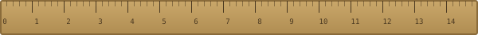

# UI 设计图 100% 复刻实施计划（Midway Command）

> **For agentic workers:** REQUIRED SUB-SKILL: Use superpowers:subagent-driven-development (recommended) or superpowers:executing-plans to implement this plan task-by-task. Steps use checkbox (`- [ ]`) syntax for tracking.

**Goal:** 100% 复刻设计图（`docs/assets/ChatGPT Image 2026年6月17日 10_55_51.png`，15 项资产的「1942 年旧海图情报桌」物料板）——设计图资产由 AI 以手写 SVG / 程序化 Canvas 自行完成，游戏实体图标复用仓库自带绿幕抠图素材并治理入库，最终组装进现有游戏界面。

**Architecture:** 零外部图片、零新增依赖。设计图 15 项资产（A1–A15）全部为 AI 编写的 SVG（`feTurbulence` 程序化纸张/噪点/划痕纹理 + 矢量图标），落在 `static/assets/ui/`（FastAPI 仅挂载 `/static`）。A1 地图主图由新模块 `static/js/chartRenderer.js` 程序化绘制。游戏实体图标（舰队计数牌、飞机顶视图等）使用仓库已有绿幕素材表经 `docs/assets/extract_icons.py` 抠图治理后的光栅 PNG。HTML/CSS 将资产组装到现有布局（顶栏/文件夹标签页/军令纸/情报卡/桌面道具/全局氛围层）。

**Tech Stack:** 原生 HTML/CSS/JS（无框架、无构建步骤）、SVG（feTurbulence/radialGradient）、Canvas 2D、Pillow + numpy（仅光栅素材治理，已随 streamlit 安装在 .venv 中）、pytest（静态资产守卫测试）、uvicorn 手动/浏览器截图视觉验证。

**Spec:**
- 设计图（唯一视觉基准）：`docs/assets/ChatGPT Image 2026年6月17日 10_55_51.png`
- `docs/design/UI_DESIGN.md`（色彩 token、字体、布局的权威数值）
- `docs/design/ART_DIRECTION.md`（环礁画法、氛围描述）
- 光栅素材源：`docs/assets/Gemini_Generated_Icon_Green.png`（绿幕素材表，2754×1536）+ `docs/assets/extract_icons.py`（现成抠图脚本）+ `docs/assets/icons_extracted/`（47 枚已抠图透明 PNG，质量参差，需评审治理）

## Global Constraints

- **零新增依赖**：不改 `requirements.txt`，不引入 JS 库/构建工具，不使用任何**仓库外**图片文件。设计图资产由 AI 手写 SVG / Canvas 代码生成；光栅图标仅允许来自仓库自带绿幕素材表的抠图产物。Pillow/numpy 已在 .venv 中（streamlit 依赖），直接使用。
- **色彩 token 逐字采用** `docs/design/UI_DESIGN.md`：`--color-desk:#3a2518`、`--color-desk-light:#4a3528`、`--color-paper-base:#f5edd6`、`--color-paper-dark:#e8dcc8`、`--color-paper-edge:#d4c8a8`、`--color-ink-main:#2a2218`、`--color-ink-fade:#6b5d4a`、`--color-ink-faint:#a89878`、`--color-enemy-red:#8b2500`、`--color-secret-red:#c0392b`、`--color-grid-line:rgba(160,140,110,0.35)`、`--color-lagoon:#b8d4c8`、`--color-reef:#8aaa98`、`--color-sand:#d4c4a0`、`--color-eastern:#c8b890`。
- **字体**：沿用既有 Google Fonts link——`'Special Elite', monospace`（打字机/仪表/标注）、`'Caveat', cursive`（手写/签名/印章点缀）。
- **资产目录**：SVG 一律 `static/assets/ui/<name>.svg`，治理后的光栅图标一律 `static/assets/ui/icons/<name>.png`（浏览器路径 `/static/assets/ui/...`）。改动 CSS/JS 后必须递增 `static/index.html` 中的 `?v=` 缓存参数。
- **TDD**：每个任务先写 `tests/test_ui_assets.py`（或 `tests/test_raster_assets.py`）中的失败断言，再实现。运行单测：`pytest tests/test_ui_assets.py::<test_name> -v`；全量：`pytest tests/`（230 个既有测试必须始终全绿）。
- **视觉验证**：`source .venv/bin/activate && uvicorn server:app --reload` 后打开 http://localhost:8000，截图与设计图逐项对照（浏览器截图工具即可）。每个 Phase 结束做一次对照。
- **外科手术式修改**：只改本计划列出的文件；不碰 `src/` 游戏逻辑；不破坏现有功能（聊天、建议审批、推进回合、侦察显示）。
- **提交**：每个任务一次 Conventional Commit（`feat:`/`fix:`/`docs:`），中文描述。
- **设计图文字乱码处理**：设计图为 AI 生成，部分英文是乱码（如 "MSSION"、"CARRIER MITE FORCE TIUNS OFF"）。**几何、构图、颜色、字体 100% 复刻；乱码文字按同位置、同字号、同长度替换为正确军事文案**（史实文案见 `docs/reference/HISTORICAL_NOTES.md`）。
- **A9 标签页**：设计图 6 枚标签（COS/TF16 CAPT/COMM/ITEL/INTEL/ADML）是装饰性占位；实现按其视觉样式精确复刻，标签文本绑定游戏真实 5 名 NPC：COS(Browning)、TF16 CAPT(Murray)、HOR CAPT(Mitscher)、COMM(通信官)、INTEL(情报官)。

## 工作量说明

本计划共 **44 个任务**、约 220 个执行步骤。按执行模型（GLM 5.3 Flash）每任务含「写失败测试→实现→测试转绿→浏览器截图对照→提交」的完整循环，单任务约 8–20 分钟（含视觉修正回环），总工作量约 **6–11 小时**，满足「连续 5 小时以上」的要求。任务按 Phase 顺序执行，Phase 内任务相互独立、可分别提交。

## 文件结构总览

**Create：**
- `tests/test_ui_assets.py` — 设计图资产守卫测试（每任务追加断言）
- `tests/test_raster_assets.py` — 光栅图标守卫测试（Phase 6）
- `static/assets/ui/` — 16 个 SVG 资产：`paper_base.svg`、`noise.svg`、`vignette.svg`、`light_falloff.svg`、`scratches.svg`、`compass.svg`、`enemy_marker.svg`、`secret_stamp.svg`、`topbar_bg.svg`、`tab_bg.svg`、`intel_card_light.svg`、`intel_card_dark.svg`、`paper_note.svg`、`ruler.svg`、`pencil.svg`、`flag48.svg`
- `static/assets/ui/icons/` — 绿幕素材治理后的光栅图标 PNG（Phase 6）
- `static/js/chartRenderer.js` — A1 地图主图程序化绘制
- `docs/reports/ui-replication-report.md` — 验收对照报告
- `docs/reports/raster-icon-review.md` — 光栅图标源池评审报告（Phase 6）

**Modify：**
- `static/css/style.css` — token 补全 + 各组件复刻样式
- `static/index.html` — 修复 meta 缺陷、叠加层、flag48、chartRenderer 脚本、缓存版本
- `static/js/svgLoader.js` — 改为「内联 + 文件加载」双通道，支持 SVG 与 PNG
- `static/js/uiController.js` — 标签页/军令纸/情报卡标记与文案
- `static/js/main.js` — 事件绑定适配（仅类名变化处）
- `static/js/mapRenderer.js` — 底图替换为 chartRenderer、实体标记改绘

---

## 设计图 → 实现映射表（验收基准）

| # | 设计图条目 | 实现物 | 使用位置 | 验收要点 |
|---|-----------|--------|---------|---------|
| A1 | 地图主图 midway_atoll_base.png | `chartRenderer.js` 程序化绘制 | 海图区 | 旧纸底、中途岛环礁（泻湖蓝绿/沙环/珊瑚礁虚线/SW 斜线阴影）、SAND ISLAND（矩形）+ EASTERN ISLAND（三角形+三条交叉跑道）、中心标注 `MIDWAY ATOLL 28°12'N 177°21'W`、20/40/60nm 虚线距离环及标注、经纬细虚线网、右上罗盘、右下分段比例尺(0-50nm)、ENT/HOR 圆圈标记+CSE 270° 航向线+虚线引导线 |
| A2 | 纸张背景 paper_base.jpg | `paper_base.svg`（feTurbulence 渍斑） | 海图底图、卡片 | 米黄底 + 低频水渍斑 |
| A3 | 暗角叠加 vignette.png | `vignette.svg`（radialGradient） | 全局叠加层 | 四周变暗、中心透明 |
| A4 | 噪点纹理 noise.png | `noise.svg`（fractalNoise） | 全局叠加 + Canvas | 细颗粒灰噪 |
| A5 | 敌方标记 enemy_marker.png | `enemy_marker.svg`（红圈问号+ENEMY） | 已知敌情接触点 | 红色 `#8b2500`、手绘双圈、大问号、ENEMY 字样；三档尺寸 |
| A6 | 罗盘 compass.png | `compass.svg` | 地图右上角 | 8 方位玫瑰、N/E/S/W 字母、双环 |
| A7 | 秘密印章 secret_stamp.png | `secret_stamp.svg` | 军令纸/情报卡 | 双线圆角边框、倾斜、红字 SECRET、做旧滤镜 |
| A8 | 任务纸张 paper_note.png | `paper_note.svg` + 军令纸组件 | 参谋建议卡 | 叠纸边缘、`SECRET – INTERCEPTION PLAN` 头、MISSION:/EXECUTION: 段落、签名、黑底 EXECUTE ORDER + 红框 REVISE PLAN |
| A9 | 标签页背景 tab_bg.png | `tab_bg.svg` + 文件夹标签 CSS | NPC 标签页 | 米黄文件夹小 tab，激活 tab 上浮 |
| A10 | 情报卡片背景 intel_card_bg.png | `intel_card_light.svg` / `intel_card_dark.svg` | 聊天消息卡 | 折角 + 投影，亮/暗两变体 |
| A11 | 顶部栏背景 topbar_bg.png | `topbar_bg.svg` | 顶栏 | 米黄纸带、做旧 |
| A12 | 遮罩光照 light_falloff.png | `light_falloff.svg` | 海图区左上（台灯光晕） | 柔和暖光斑 |
| A13 | 划痕纹理 scratches.png | `scratches.svg` | 海图区 | 细划痕线，极低不透明度 |
| A14 | 尺子 ruler.png | `ruler.svg` | 底部桌面右侧 | 木色尺身、刻度、数字 |
| A15 | 铅笔 pencil.png | `pencil.svg` | 底部桌面左侧 | 黄杆/木尖/笔芯/金属箍/橡皮 |
| 补 | （顶栏需要）48 星美国旗 | `flag48.svg` | 顶栏（替换 🇺🇸 emoji） | 13 道条 + 蓝色星区 |
| 补2 | （非设计图条目）绿幕素材表实体图标 | `static/assets/ui/icons/*.png` | 地图舰队计数牌、飞机编队 | 透明 RGBA、无绿边、无合并切割；质量不合格者由 SVG 顶替 |

---

## Phase 0 — 基线与守卫测试

### Task 0.1: 修复 index.html meta 缺陷 + 建立资产目录

**Files:**
- Modify: `static/index.html:5-7`
- Create: `static/assets/ui/.gitkeep`

**Interfaces:**
- Produces: 合法的 `http-equiv="Cache-Control"` meta；后续所有资产落在 `static/assets/ui/`。

- [ ] **Step 1: 确认缺陷**

Run: `grep -n 'http-equiv' static/index.html`
Expected: `<meta http-equiv=1780997976"Cache-Control" ...>` —— 版本号被错误拼进属性名，Cache-Control meta 实际失效。

- [ ] **Step 2: 修复**

将三行 meta 改为：

```html
  <meta http-equiv="Cache-Control" content="no-cache, no-store, must-revalidate">
  <meta http-equiv="Pragma" content="no-cache">
  <meta name="viewport" content="width=device-width, initial-scale=1">
```

- [ ] **Step 3: 建目录**

```bash
mkdir -p static/assets/ui && touch static/assets/ui/.gitkeep
```

- [ ] **Step 4: 浏览器验证** — 打开 http://localhost:8000，页面正常（硬刷新 Cmd+Shift+R）。

- [ ] **Step 5: Commit**

```bash
git add static/index.html static/assets/ui/.gitkeep
git commit -m "fix: 修复 index.html meta http-equiv 属性拼接缺陷"
```

### Task 0.2: 资产守卫测试骨架（先失败）

**Files:**
- Create: `tests/test_ui_assets.py`

**Interfaces:**
- Produces: `ASSET_MANIFEST`（后续资产任务的验收依据）、`CSS_TOKENS`（token 权威断言）。

- [ ] **Step 1: 写测试**

```python
"""UI 设计图复刻守卫测试。

校验 docs/plans/ui-replication-plan.md 定义的资产文件、设计 token、
页面结构与渲染器常量的静态一致性。前端无 JS 测试运行器，
本文件是 UI 复刻的自动化回归防线。
"""
import re
import xml.etree.ElementTree as ET
from pathlib import Path

BASE = Path(__file__).resolve().parent.parent
UI = BASE / "static" / "assets" / "ui"

# 设计图 15 项资产 → (文件名, 必含内容关键字)
# A1 地图主图为 chartRenderer.js 程序化绘制，由 test_chart_renderer_* 单独守卫。
ASSET_MANIFEST = {
    "A2_paper_base":     ("paper_base.svg",     ["feTurbulence", "#f5edd6"]),
    "A3_vignette":       ("vignette.svg",       ["radialGradient"]),
    "A4_noise":          ("noise.svg",          ["feTurbulence", "fractalNoise"]),
    "A5_enemy_marker":   ("enemy_marker.svg",   ["#8b2500", "ENEMY"]),
    "A6_compass":        ("compass.svg",        [">N<", ">E<", ">S<", ">W<"]),
    "A7_secret_stamp":   ("secret_stamp.svg",   ["#c0392b", "SECRET"]),
    "A8_paper_note":     ("paper_note.svg",     ["feTurbulence"]),
    "A9_tab_bg":         ("tab_bg.svg",         ["viewBox"]),
    "A10_intel_card_l":  ("intel_card_light.svg", ["viewBox"]),
    "A10_intel_card_d":  ("intel_card_dark.svg",  ["viewBox"]),
    "A11_topbar_bg":     ("topbar_bg.svg",      ["viewBox", "#f5edd6"]),
    "A12_light_falloff": ("light_falloff.svg",  ["radialGradient"]),
    "A13_scratches":     ("scratches.svg",      ["stroke"]),
    "A14_ruler":         ("ruler.svg",          ["viewBox"]),
    "A15_pencil":        ("pencil.svg",         ["viewBox"]),
    "EX_flag48":         ("flag48.svg",         ["viewBox"]),
}

CSS_TOKENS = {
    "--color-desk": "#3a2518",
    "--color-desk-light": "#4a3528",
    "--color-paper-base": "#f5edd6",
    "--color-paper-dark": "#e8dcc8",
    "--color-paper-edge": "#d4c8a8",
    "--color-ink-main": "#2a2218",
    "--color-ink-fade": "#6b5d4a",
    "--color-ink-faint": "#a89878",
    "--color-enemy-red": "#8b2500",
    "--color-secret-red": "#c0392b",
    "--color-grid-line": "rgba(160,140,110,0.35)",
    "--color-lagoon": "#b8d4c8",
    "--color-reef": "#8aaa98",
    "--color-sand": "#d4c4a0",
    "--color-eastern": "#c8b890",
    "--font-handwriting": "'Caveat', cursive",
    "--font-typewriter": "'Special Elite', monospace",
}


def test_asset_manifest_complete():
    missing = [name for name, (f, _) in ASSET_MANIFEST.items() if not (UI / f).exists()]
    assert missing == [], f"缺少资产文件: {missing}"


def test_assets_are_valid_svg_with_required_content():
    for name, (fname, keywords) in ASSET_MANIFEST.items():
        path = UI / fname
        if not path.exists():
            continue  # 缺失由 test_asset_manifest_complete 报告
        ET.parse(path)  # XML 必须合法
        for kw in keywords:
            assert kw in path.read_text(), f"{name}: {fname} 缺少关键字 {kw}"


def test_style_css_has_exact_design_tokens():
    css = (BASE / "static" / "css" / "style.css").read_text()
    for token, value in CSS_TOKENS.items():
        assert f"{token}: {value};" in css, f"token {token} 必须精确为 {value}"


def test_index_html_structure():
    html = (BASE / "static" / "index.html").read_text()
    for el_id in ["topbar", "chart-area", "tacticalMap", "bottom", "dashboard",
                  "sidebar", "npc-tabs", "chat-log", "suggestions", "input-bar",
                  "vignette-overlay", "noise-overlay"]:
        assert f'id="{el_id}"' in html, f"index.html 缺少 #{el_id}"
    assert 'http-equiv="Cache-Control"' in html, "meta 缓存标签未修复"
```

- [ ] **Step 2: 运行确认失败**

Run: `pytest tests/test_ui_assets.py -v`
Expected: FAIL —— `test_asset_manifest_complete`（16 个文件缺失）、`test_style_css_has_exact_design_tokens`（缺 lagoon/reef/sand/eastern token，grid-line 为 0.4）、`test_index_html_structure`（缺 overlay id）。

- [ ] **Step 3: Commit（红测入库）**

```bash
git add tests/test_ui_assets.py
git commit -m "test: UI 复刻守卫测试骨架（资产清单/token/页面结构）"
```

### Task 0.3: 视觉基线截图

- [ ] **Step 1:** 启动 `uvicorn server:app --reload`，用浏览器截图工具截取整页（1280×800 与 1920×1080 各一张），存 `docs/reports/baseline-1280.png`、`docs/reports/baseline-1920.png`。
- [ ] **Step 2:** 打开设计图与基线截图对照，在 `docs/reports/ui-replication-report.md` 建立验收表（15 行，状态列全部「未开始」）。
- [ ] **Step 3: Commit**

```bash
git add docs/reports/
git commit -m "docs: UI 复刻基线截图与验收报告骨架"
```

---

## Phase 1 — 设计 token 基座

### Task 1.1: 补全 style.css 设计 token

**Files:**
- Modify: `static/css/style.css:6-22`（`:root` 块）

**Interfaces:**
- Consumes: `CSS_TOKENS`（tests/test_ui_assets.py）。
- Produces: 全部 17 个 CSS 变量，后续所有任务引用。

- [ ] **Step 1: 确认失败** — Run: `pytest tests/test_ui_assets.py::test_style_css_has_exact_design_tokens -v` → FAIL。

- [ ] **Step 2: 替换 `:root` 块为**

```css
:root {
  --color-desk: #3a2518;
  --color-desk-light: #4a3528;
  --color-paper-base: #f5edd6;
  --color-paper-dark: #e8dcc8;
  --color-paper-edge: #d4c8a8;
  --color-ink-main: #2a2218;
  --color-ink-fade: #6b5d4a;
  --color-ink-faint: #a89878;
  --color-enemy-red: #8b2500;
  --color-secret-red: #c0392b;
  --color-grid-line: rgba(160, 140, 110, 0.35);
  --color-lagoon: #b8d4c8;
  --color-reef: #8aaa98;
  --color-sand: #d4c4a0;
  --color-eastern: #c8b890;

  --font-handwriting: 'Caveat', cursive;
  --font-typewriter: 'Special Elite', monospace;
}
```

- [ ] **Step 3: 转绿** — Run: `pytest tests/test_ui_assets.py::test_style_css_has_exact_design_tokens -v` → PASS。再跑 `pytest tests/` 确认无回归。
- [ ] **Step 4: 浏览器验证** — 页面无样式错乱（token 值仅 grid-line 透明度微调）。
- [ ] **Step 5: Commit**

```bash
git add static/css/style.css
git commit -m "feat: 补全 UI 设计 token（海图色板/字体变量）"
```

---

## Phase 2 — 纹理资产（A2/A3/A4/A12/A13）

### Task 2.1: paper_base.svg 纸张底纹

**Files:**
- Create: `static/assets/ui/paper_base.svg`

- [ ] **Step 1: 确认失败** — `pytest tests/test_ui_assets.py::test_asset_manifest_complete -v` → FAIL（列出缺 paper_base.svg）。

- [ ] **Step 2: 写文件**

```svg
<svg xmlns="http://www.w3.org/2000/svg" width="1200" height="900" viewBox="0 0 1200 900">
  <defs>
    <filter id="stains" x="0" y="0" width="100%" height="100%">
      <feTurbulence type="fractalNoise" baseFrequency="0.012" numOctaves="3" seed="11"/>
      <feColorMatrix type="matrix" values="0 0 0 0 0.55  0 0 0 0 0.45  0 0 0 0 0.28  0 0 0 0.55 0"/>
      <feComponentTransfer><feFuncA type="discrete" tableValues="0 0 0 0 0 0.25 0 0.45"/></feComponentTransfer>
    </filter>
    <filter id="grain" x="0" y="0" width="100%" height="100%">
      <feTurbulence type="fractalNoise" baseFrequency="0.9" numOctaves="2" seed="7"/>
      <feColorMatrix type="matrix" values="0 0 0 0 0.42  0 0 0 0 0.36  0 0 0 0 0.26  0 0 0 0.18 0"/>
    </filter>
  </defs>
  <rect width="1200" height="900" fill="#f5edd6"/>
  <rect width="1200" height="900" filter="url(#stains)" opacity="0.5"/>
  <rect width="1200" height="900" filter="url(#grain)"/>
</svg>
```

- [ ] **Step 3: 转绿** — `pytest tests/test_ui_assets.py::test_assets_are_valid_svg_with_required_content -v` → 该资产关键字通过。
- [ ] **Step 4: 视觉验证** — 浏览器直接打开 http://localhost:8000/static/assets/ui/paper_base.svg：米黄纸面 + 稀疏褐斑。
- [ ] **Step 5: Commit**

```bash
git add static/assets/ui/paper_base.svg
git commit -m "feat: A2 纸张底纹资产（feTurbulence 渍斑）"
```

### Task 2.2: noise.svg 噪点纹理

**Files:** Create: `static/assets/ui/noise.svg`

- [ ] **Step 1: 红测**（manifest 断言）→ **Step 2: 写文件**

```svg
<svg xmlns="http://www.w3.org/2000/svg" width="600" height="600" viewBox="0 0 600 600">
  <filter id="n" x="0" y="0" width="100%" height="100%">
    <feTurbulence type="fractalNoise" baseFrequency="0.8" numOctaves="4" seed="3"/>
    <feColorMatrix type="matrix" values="0 0 0 0 0.16  0 0 0 0 0.13  0 0 0 0 0.09  0 0 0 0.5 0"/>
  </filter>
  <rect width="600" height="600" filter="url(#n)"/>
</svg>
```

- [ ] **Step 3: 转绿 + 视觉验证**（半透明深灰细噪点）→ **Step 4: Commit** `feat: A4 噪点纹理资产`

### Task 2.3: vignette.svg 暗角

**Files:** Create: `static/assets/ui/vignette.svg`

- [ ] **Step 1: 红测** → **Step 2: 写文件**

```svg
<svg xmlns="http://www.w3.org/2000/svg" width="1200" height="900" viewBox="0 0 1200 900">
  <defs>
    <radialGradient id="v" cx="50%" cy="46%" r="75%">
      <stop offset="0%" stop-color="#3a2518" stop-opacity="0"/>
      <stop offset="55%" stop-color="#3a2518" stop-opacity="0"/>
      <stop offset="85%" stop-color="#3a2518" stop-opacity="0.28"/>
      <stop offset="100%" stop-color="#1e120a" stop-opacity="0.6"/>
    </radialGradient>
  </defs>
  <rect width="1200" height="900" fill="url(#v)"/>
</svg>
```

- [ ] **Step 3: 转绿 + 视觉验证**（四角变暗、中心透明）→ **Step 4: Commit** `feat: A3 暗角叠加资产`

### Task 2.4: light_falloff.svg 台灯光晕

**Files:** Create: `static/assets/ui/light_falloff.svg`

- [ ] **Step 1: 红测** → **Step 2: 写文件**

```svg
<svg xmlns="http://www.w3.org/2000/svg" width="900" height="700" viewBox="0 0 900 700">
  <defs>
    <radialGradient id="l" cx="50%" cy="50%" r="50%">
      <stop offset="0%" stop-color="#fff4d6" stop-opacity="0.85"/>
      <stop offset="40%" stop-color="#ffedc4" stop-opacity="0.45"/>
      <stop offset="100%" stop-color="#ffedc4" stop-opacity="0"/>
    </radialGradient>
  </defs>
  <rect width="900" height="700" fill="url(#l)"/>
</svg>
```

- [ ] **Step 3: 转绿 + 视觉验证**（暖色柔光斑）→ **Step 4: Commit** `feat: A12 遮罩光照资产`

### Task 2.5: scratches.svg 划痕

**Files:** Create: `static/assets/ui/scratches.svg`

- [ ] **Step 1: 红测** → **Step 2: 写文件**

```svg
<svg xmlns="http://www.w3.org/2000/svg" width="1200" height="900" viewBox="0 0 1200 900">
  <g stroke="#6b5d4a" stroke-linecap="round" fill="none">
    <line x1="80"  y1="120" x2="340" y2="90"  stroke-width="1" opacity="0.14"/>
    <line x1="900" y1="200" x2="1150" y2="260" stroke-width="0.8" opacity="0.12"/>
    <line x1="200" y1="700" x2="520" y2="760" stroke-width="1" opacity="0.15"/>
    <line x1="760" y1="640" x2="980" y2="820" stroke-width="0.8" opacity="0.10"/>
    <line x1="480" y1="60"  x2="500" y2="180" stroke-width="0.6" opacity="0.12"/>
    <line x1="1100" y1="500" x2="1120" y2="640" stroke-width="0.6" opacity="0.12"/>
  </g>
</svg>
```

- [ ] **Step 3: 转绿 + 视觉验证** → **Step 4: Commit** `feat: A13 划痕纹理资产`

---

## Phase 3 — 图标资产（A5/A6/A7）

### Task 3.1: compass.svg 罗盘玫瑰

**Files:** Create: `static/assets/ui/compass.svg`

- [ ] **Step 1: 红测**（manifest 要求含 `>N< >E< >S< >W<`）→ **Step 2: 写文件**

```svg
<svg xmlns="http://www.w3.org/2000/svg" width="200" height="200" viewBox="0 0 200 200">
  <g stroke="#2a2218" fill="none">
    <circle cx="100" cy="100" r="92" stroke-width="2"/>
    <circle cx="100" cy="100" r="64" stroke-width="1"/>
    <circle cx="100" cy="100" r="6" stroke-width="1.5"/>
  </g>
  <!-- 主方位（长）菱形针：明暗两半 -->
  <g id="cardinal">
    <polygon points="100,10 108,100 100,100" fill="#2a2218"/>
    <polygon points="100,10 92,100 100,100" fill="#f5edd6" stroke="#2a2218" stroke-width="1"/>
    <polygon points="100,190 108,100 100,100" fill="#2a2218"/>
    <polygon points="100,190 92,100 100,100" fill="#f5edd6" stroke="#2a2218" stroke-width="1"/>
    <polygon points="10,100 100,92 100,100" fill="#f5edd6" stroke="#2a2218" stroke-width="1"/>
    <polygon points="10,100 100,108 100,100" fill="#2a2218"/>
    <polygon points="190,100 100,92 100,100" fill="#2a2218"/>
    <polygon points="190,100 100,108 100,100" fill="#f5edd6" stroke="#2a2218" stroke-width="1"/>
  </g>
  <use href="#cardinal" transform="rotate(45 100 100)"/>
  <!-- 方位字母 -->
  <g font-family="'Special Elite', monospace" font-size="16" fill="#2a2218" text-anchor="middle">
    <text x="100" y="30">N</text>
    <text x="176" y="106">E</text>
    <text x="100" y="184">S</text>
    <text x="24" y="106">W</text>
  </g>
</svg>
```

- [ ] **Step 3: 转绿 + 视觉验证**（8 针玫瑰、字母清晰）→ **Step 4: Commit** `feat: A6 罗盘玫瑰图标`

### Task 3.2: enemy_marker.svg 敌方标记

**Files:** Create: `static/assets/ui/enemy_marker.svg`

- [ ] **Step 1: 红测**（要求 `#8b2500`、`ENEMY`）→ **Step 2: 写文件**（手绘感双圈 + Caveat 问号 + ENEMY 字样，viewBox 高含文字区）

```svg
<svg xmlns="http://www.w3.org/2000/svg" width="120" height="150" viewBox="0 0 120 150">
  <g fill="none" stroke="#8b2500" stroke-linecap="round">
    <circle cx="60" cy="56" r="42" stroke-width="5"/>
    <circle cx="61" cy="54" r="39" stroke-width="2" opacity="0.75"/>
  </g>
  <text x="60" y="80" text-anchor="middle" font-family="'Caveat', cursive"
        font-size="64" font-weight="bold" fill="#8b2500">?</text>
  <text x="60" y="138" text-anchor="middle" font-family="'Special Elite', monospace"
        font-size="20" letter-spacing="4" fill="#8b2500">ENEMY</text>
</svg>
```

- [ ] **Step 3: 转绿 + 视觉验证** → **Step 4: Commit** `feat: A5 敌方未知接触标记`

### Task 3.3: secret_stamp.svg 秘密印章

**Files:** Create: `static/assets/ui/secret_stamp.svg`

- [ ] **Step 1: 红测**（要求 `#c0392b`、`SECRET`）→ **Step 2: 写文件**（倾斜 + 做旧 displacement）

```svg
<svg xmlns="http://www.w3.org/2000/svg" width="260" height="110" viewBox="0 0 260 110">
  <defs>
    <filter id="distress">
      <feTurbulence type="fractalNoise" baseFrequency="0.15" numOctaves="2" seed="5" result="t"/>
      <feDisplacementMap in="SourceGraphic" in2="t" scale="3"/>
    </filter>
  </defs>
  <g transform="rotate(-6 130 55)" filter="url(#distress)">
    <rect x="10" y="18" width="240" height="74" rx="6" fill="none" stroke="#c0392b" stroke-width="6"/>
    <rect x="20" y="28" width="220" height="54" rx="3" fill="none" stroke="#c0392b" stroke-width="2"/>
    <text x="130" y="72" text-anchor="middle" font-family="'Special Elite', monospace"
          font-size="42" font-weight="bold" letter-spacing="10" fill="#c0392b">SECRET</text>
  </g>
</svg>
```

- [ ] **Step 3: 转绿 + 视觉验证** → **Step 4: Commit** `feat: A7 SECRET 印章资产`

---

## Phase 4 — UI 组件背景（A11/A9/A10/A8）

### Task 4.1: topbar_bg.svg 顶栏纸带

**Files:** Create: `static/assets/ui/topbar_bg.svg`

- [ ] **Step 1: 红测** → **Step 2: 写文件**

```svg
<svg xmlns="http://www.w3.org/2000/svg" width="1600" height="48" viewBox="0 0 1600 48" preserveAspectRatio="none">
  <defs>
    <filter id="tg" x="0" y="0" width="100%" height="100%">
      <feTurbulence type="fractalNoise" baseFrequency="0.7" numOctaves="2" seed="9"/>
      <feColorMatrix type="matrix" values="0 0 0 0 0.42  0 0 0 0 0.36  0 0 0 0 0.26  0 0 0 0.12 0"/>
    </filter>
  </defs>
  <rect width="1600" height="48" fill="#f5edd6"/>
  <rect width="1600" height="48" filter="url(#tg)"/>
  <circle cx="1380" cy="40" r="26" fill="#d4c8a8" opacity="0.25"/>
  <rect y="46" width="1600" height="2" fill="#a89878"/>
</svg>
```

- [ ] **Step 3: 转绿 + 视觉验证** → **Step 4: Commit** `feat: A11 顶栏纸张背景资产`

### Task 4.2: tab_bg.svg 文件夹标签条

**Files:** Create: `static/assets/ui/tab_bg.svg`

- [ ] **Step 1: 红测** → **Step 2: 写文件**（标签本身形状由 CSS clip-path 绘制；本资产提供纸带底 + 折影）

```svg
<svg xmlns="http://www.w3.org/2000/svg" width="600" height="40" viewBox="0 0 600 40" preserveAspectRatio="none">
  <rect width="600" height="40" fill="#e8dcc8"/>
  <rect y="34" width="600" height="6" fill="#d4c8a8"/>
  <rect y="34" width="600" height="1" fill="#a89878"/>
</svg>
```

- [ ] **Step 3: 转绿 → Step 4: Commit** `feat: A9 标签页背景资产`

### Task 4.3: intel_card_light/dark.svg 情报卡

**Files:** Create: `static/assets/ui/intel_card_light.svg`、`static/assets/ui/intel_card_dark.svg`

- [ ] **Step 1: 红测** → **Step 2: 写亮色卡**

```svg
<svg xmlns="http://www.w3.org/2000/svg" width="320" height="140" viewBox="0 0 320 140">
  <polygon points="0,0 296,0 320,24 320,140 0,140" fill="#f5edd6" stroke="#a89878" stroke-width="1"/>
  <polygon points="296,0 296,24 320,24" fill="#d4c8a8" stroke="#a89878" stroke-width="1"/>
</svg>
```

与暗色卡（机密变体）：

```svg
<svg xmlns="http://www.w3.org/2000/svg" width="320" height="140" viewBox="0 0 320 140">
  <polygon points="0,0 296,0 320,24 320,140 0,140" fill="#4a3f30" stroke="#2a2218" stroke-width="1"/>
  <polygon points="296,0 296,24 320,24" fill="#2a2218" stroke="#2a2218" stroke-width="1"/>
</svg>
```

- [ ] **Step 3: 转绿 + 视觉验证**（折角在右上、双变体）→ **Step 4: Commit** `feat: A10 情报卡片背景（亮/暗变体）`

### Task 4.4: paper_note.svg 军令叠纸

**Files:** Create: `static/assets/ui/paper_note.svg`

- [ ] **Step 1: 红测**（要求 feTurbulence）→ **Step 2: 写文件**（三张错位叠纸 + 毛边 displacement）

```svg
<svg xmlns="http://www.w3.org/2000/svg" width="360" height="420" viewBox="0 0 360 420">
  <defs>
    <filter id="rough">
      <feTurbulence type="fractalNoise" baseFrequency="0.05" numOctaves="3" seed="4" result="t"/>
      <feDisplacementMap in="SourceGraphic" in2="t" scale="4"/>
    </filter>
  </defs>
  <g filter="url(#rough)">
    <rect x="18" y="14" width="326" height="396" fill="#e8dcc8" stroke="#a89878" transform="rotate(1.6 181 212)"/>
    <rect x="10" y="8" width="330" height="400" fill="#efe6cd" stroke="#a89878" transform="rotate(-1.2 175 208)"/>
    <rect x="14" y="4" width="332" height="404" fill="#f5edd6" stroke="#a89878"/>
  </g>
</svg>
```

- [ ] **Step 3: 转绿 + 视觉验证** → **Step 4: Commit** `feat: A8 任务叠纸背景资产`

---

## Phase 5 — 桌面道具（A14/A15）

### Task 5.1: ruler.svg 木尺

**Files:** Create: `static/assets/ui/ruler.svg`

- [ ] **Step 1: 红测** → **Step 2: 写文件**（pattern 复用刻度）

```svg
<svg xmlns="http://www.w3.org/2000/svg" width="600" height="44" viewBox="0 0 600 44">
  <defs>
    <linearGradient id="wood" x1="0" y1="0" x2="0" y2="1">
      <stop offset="0%" stop-color="#c9a76a"/>
      <stop offset="100%" stop-color="#b08d52"/>
    </linearGradient>
    <pattern id="minor" width="8" height="44" patternUnits="userSpaceOnUse">
      <line x1="0" y1="0" x2="0" y2="8" stroke="#4a3820" stroke-width="1"/>
    </pattern>
    <pattern id="major" width="40" height="44" patternUnits="userSpaceOnUse">
      <line x1="0" y1="0" x2="0" y2="16" stroke="#4a3820" stroke-width="2"/>
    </pattern>
  </defs>
  <rect x="1" y="1" width="598" height="42" rx="2" fill="url(#wood)" stroke="#8a6b3a" stroke-width="2"/>
  <rect x="1" y="1" width="598" height="42" fill="url(#minor)"/>
  <rect x="1" y="1" width="598" height="42" fill="url(#major)"/>
  <g font-family="'Special Elite', monospace" font-size="9" fill="#4a3820" text-anchor="middle">
    <text x="6" y="30">0</text><text x="46" y="30">1</text><text x="86" y="30">2</text>
    <text x="126" y="30">3</text><text x="166" y="30">4</text><text x="206" y="30">5</text>
    <text x="246" y="30">6</text><text x="286" y="30">7</text><text x="326" y="30">8</text>
    <text x="366" y="30">9</text><text x="406" y="30">10</text><text x="446" y="30">11</text>
    <text x="486" y="30">12</text><text x="526" y="30">13</text><text x="566" y="30">14</text>
  </g>
</svg>
```

- [ ] **Step 3: 转绿 + 视觉验证**（刻度均匀、数字清晰）→ **Step 4: Commit** `feat: A14 木尺道具资产`

### Task 5.2: pencil.svg 铅笔

**Files:** Create: `static/assets/ui/pencil.svg`

- [ ] **Step 1: 红测** → **Step 2: 写文件**

```svg
<svg xmlns="http://www.w3.org/2000/svg" width="420" height="36" viewBox="0 0 420 36">
  <!-- 笔杆 -->
  <rect x="60" y="8" width="300" height="20" fill="#e8a33d"/>
  <line x1="60" y1="14" x2="360" y2="14" stroke="#c8871f" stroke-width="1"/>
  <line x1="60" y1="22" x2="360" y2="22" stroke="#c8871f" stroke-width="1"/>
  <!-- 金属箍 -->
  <rect x="360" y="7" width="22" height="22" fill="#b8b8c0"/>
  <line x1="366" y1="7" x2="366" y2="29" stroke="#8f8f9a" stroke-width="1.5"/>
  <line x1="373" y1="7" x2="373" y2="29" stroke="#8f8f9a" stroke-width="1.5"/>
  <!-- 橡皮 -->
  <rect x="382" y="7" width="26" height="22" rx="9" fill="#d88a7c"/>
  <!-- 木尖 + 笔芯 -->
  <polygon points="60,8 60,28 18,24 60,8" fill="#d4b890"/>
  <polygon points="60,8 60,28 18,24" fill="none" stroke="#b08d52" stroke-width="1"/>
  <polygon points="30,23 18,24 28,20" fill="#3a3228"/>
</svg>
```

- [ ] **Step 3: 转绿 + 视觉验证** → **Step 4: Commit** `feat: A15 铅笔道具资产`

---

## Phase 6 — 光栅图标素材（绿幕抠图治理与接入）

> 仓库已有光栅素材链路：绿幕素材表 `docs/assets/Gemini_Generated_Icon_Green.png`（2754×1536）→ 抠图脚本 `docs/assets/extract_icons.py`（角点取色背景掩膜 + 绿色溢出抑制 + 边界裁剪）→ `docs/assets/icons_extracted/` 47 枚透明 PNG（fleet 14 / button 9 / status_bar 8 / aircraft 6 / compass 4 / text_style 4 / map_tool 2）。**已知质量问题**：部分切割把多枚图标并进同一张（如 `aircraft_14_232x161.png` = ENT 名牌 + 飞机两枚）、部分碎片化/过暗（如 `compass_08`）。本阶段治理后择优入库，不合格者由 Phase 2–5 的 SVG 资产顶替。

### Task 6.1: 源池盘点与质量门评审

**Files:**
- Create: `docs/reports/raster-icon-review.md`

- [ ] **Step 1: 盘点统计**

```bash
ls docs/assets/icons_extracted/ | wc -l   # 应为 47
ls docs/assets/icons_extracted/ | sed 's/_[0-9].*//' | sort | uniq -c
```

- [ ] **Step 2: 跑 alpha 审查脚本**（透明度/不透明占比，识别碎片化素材）

```bash
.venv/bin/python - <<'PY'
from PIL import Image
from pathlib import Path
src = Path("docs/assets/icons_extracted")
for f in sorted(src.glob("*.png")):
    im = Image.open(f)
    opaque = sum(1 for v in im.getchannel("A").getdata() if v > 0) / (im.width * im.height)
    print(f"{f.name:32s} {im.width:4d}x{im.height:<4d} 不透明占比 {opaque:.0%}")
PY
```

- [ ] **Step 3: 逐枚目检分三档** — 用浏览器/图片查看器逐张过（或拼一张预览图看整体），把每枚图标记入 `docs/reports/raster-icon-review.md`：

```markdown
# 光栅图标源池评审（Phase 6）
| 文件 | 尺寸 | 档位 | 用途/问题 |
|------|------|------|----------|
| aircraft_14_232x161.png | 232x161 | repair | ENT 名牌 + 飞机被合并切割，需分拆 |
| compass_08_116x38.png   | 116x38  | reject | 碎片化，由 A6 compass.svg 顶替 |
| …（47 行全量登记）      |        |        |          |

分档规则：usable=可原地入库；repair=需重切/分拆/调参重抠；reject=弃用，由 SVG 顶替。
```

- [ ] **Step 4: Commit**

```bash
git add docs/reports/raster-icon-review.md
git commit -m "docs: 光栅图标源池评审报告（47 枚三档分类）"
```

### Task 6.2: 重切与分拆修复（repair 档）

**Files:**
- Modify: `docs/reports/raster-icon-review.md`（登记修复结果）

- [ ] **Step 1: 确认 numpy 可用**（extract_icons.py 依赖）— Run: `.venv/bin/python -c "import numpy; print(numpy.__version__)"`，若 ImportError 则 STOP 并在报告中标注「光栅链路降级为纯 SVG」。
- [ ] **Step 2: 重切整表**（对绿幕表跑一次现成脚本，与旧产物对比是否有更完整的切割）

```bash
.venv/bin/python docs/assets/extract_icons.py "docs/assets/Gemini_Generated_Icon_Green.png" /tmp/icons_recut
ls /tmp/icons_recut | wc -l
```

- [ ] **Step 3: 分拆合并切割**（以 6.1 目检确定的分割坐标为准，逐枚处理 repair 档）

```python
# 一次性分拆脚本（命令行运行），示例：aircraft_14 左半 ENT 名牌、右半飞机
from PIL import Image
from pathlib import Path

def split_icon(src, splits, out_dir="/tmp/icons_fixed"):
    """splits: {输出名: (x1, y1, x2, y2)}，坐标来自放大目检。"""
    im = Image.open(src).convert("RGBA")
    out = Path(out_dir); out.mkdir(parents=True, exist_ok=True)
    for name, box in splits.items():
        crop = im.crop(box)
        crop.save(out / f"{name}.png")
        print(name, crop.size)

split_icon("docs/assets/icons_extracted/aircraft_14_232x161.png", {
    "fleet_tag_ent":    (0,   0, 110, 161),
    "aircraft_topdown": (110, 0, 232, 161),
})
```

分拆后逐张目检：透明背景完整、无绿边（`extract_icons.py` 已做溢出抑制，手工分拆不会引入新绿边）。

- [ ] **Step 4: 回写报告** — repair 档逐条标注「已修复（方式）/仍失败（由 SVG 顶替）」。
- [ ] **Step 5: Commit**

```bash
git add docs/reports/raster-icon-review.md
git commit -m "docs: 光栅图标修复登记（重切/分拆结果）"
```

### Task 6.3: 归一化入库 + 守卫测试

**Files:**
- Create: `docs/assets/curate_icons.py`、`static/assets/ui/icons/`、`tests/test_raster_assets.py`

**Interfaces:**
- Produces: `static/assets/ui/icons/` 下至少 4 枚治理后的 PNG（`fleet_tag_ent.png`、`aircraft_topdown.png`、`fleet_counter.png`、`fleet_counter_wide.png`），供 svgLoader 与地图标记使用。

- [ ] **Step 1: 写失败测试**

```python
"""光栅图标素材守卫（docs/plans/ui-replication-plan.md Phase 6）。"""
from pathlib import Path
from PIL import Image

BASE = Path(__file__).resolve().parent.parent
DST = BASE / "static" / "assets" / "ui" / "icons"

# 输出名 → 最大边长 px。与 docs/assets/curate_icons.py 的 TARGETS 保持一致。
RASTER_ICONS = {
    "fleet_tag_ent.png": 64,
    "aircraft_topdown.png": 72,
    "fleet_counter.png": 96,
    "fleet_counter_wide.png": 128,
}


def test_raster_icons_exist():
    missing = [f for f in RASTER_ICONS if not (DST / f).exists()]
    assert missing == [], f"缺少光栅图标: {missing}"


def test_raster_icons_rgba_nonempty_within_size():
    for fname, max_edge in RASTER_ICONS.items():
        p = DST / fname
        if not p.exists():
            continue
        im = Image.open(p)
        assert im.mode == "RGBA", f"{fname} 必须为 RGBA"
        assert im.getchannel("A").getextrema()[1] > 0, f"{fname} 全透明（抠图失败）"
        assert max(im.size) <= max_edge + 2, f"{fname} 超出目标尺寸 {max_edge}"
```

Run: `pytest tests/test_raster_assets.py -v` → FAIL（icons 目录不存在）。

- [ ] **Step 2: 写治理脚本**

```python
#!/usr/bin/env python3
"""光栅图标治理：裁边 → 限尺寸 → 入库 static/assets/ui/icons/。

源池与分档见 docs/reports/raster-icon-review.md。
若某源文件在评审中为 reject，删除对应行并在报告中登记由 SVG 顶替。
"""
from pathlib import Path
from PIL import Image

SRC = Path(__file__).parent / "icons_extracted"
DST = Path(__file__).parent.parent / "static" / "assets" / "ui" / "icons"

# (源文件, 输出名, 最大边长 px)
TARGETS = [
    ("aircraft_14_232x161.png", "fleet_tag_ent.png", 64),      # repair 分拆产物
    ("aircraft_16_122x161.png", "aircraft_topdown.png", 72),
    ("fleet_02_104x58.png", "fleet_counter.png", 96),
    ("fleet_05_170x54.png", "fleet_counter_wide.png", 128),
]


def trim(im):
    bbox = im.getchannel("A").getbbox()
    return im.crop(bbox) if bbox else im


for src_name, out_name, max_edge in TARGETS:
    im = trim(Image.open(SRC / src_name).convert("RGBA"))
    scale = max_edge / max(im.size)
    if scale < 1:
        im = im.resize((round(im.width * scale), round(im.height * scale)), Image.LANCZOS)
    DST.mkdir(parents=True, exist_ok=True)
    im.save(DST / out_name)
    print(f"{out_name}: {im.size}")
```

（分拆产物暂存 `/tmp/icons_fixed/` 的，先把分拆输出目录改到 `docs/assets/icons_extracted/` 同级或直接改 TARGETS 指向 `/tmp` 路径，保证脚本可重复运行。）

- [ ] **Step 3: 运行 + 转绿**

```bash
.venv/bin/python docs/assets/curate_icons.py
pytest tests/test_raster_assets.py -v   # PASS
```

- [ ] **Step 4: 视觉验证** — 浏览器打开 http://localhost:8000/static/assets/ui/icons/fleet_tag_ent.png（需 uvicorn 运行）：透明底、无绿边、边缘干净。
- [ ] **Step 5: Commit**

```bash
git add docs/assets/curate_icons.py static/assets/ui/icons/ tests/test_raster_assets.py
git commit -m "feat: 光栅图标治理入库（裁边/限尺寸/RGBA 守卫测试）"
```

### Task 6.4: svgLoader 支持 PNG 光栅图标

**Files:**
- Modify: `static/js/svgLoader.js`

**Interfaces:**
- Consumes: `static/assets/ui/icons/*.png`（Task 6.3）。
- Produces: `getIcon('fleet_tag_ent' | 'aircraft_topdown' | 'fleet_counter' | 'fleet_counter_wide')` 返回 `Image`；既有 `getIcon(name)` API 不变。

- [ ] **Step 1: ICON_FILES 追加 PNG 条目并加类型分支**（`ICON_FILES` 与 `svgFromUrl` 已在 Task 7.2 定义，若本任务先于 Phase 7 执行，则把两个片段都放进本任务）

```javascript
// 光栅图标（Phase 6 治理产物）
const ICON_FILES = {
  // …SVG 条目保持不变…
  fleet_tag_ent: '/static/assets/ui/icons/fleet_tag_ent.png',
  aircraft_topdown: '/static/assets/ui/icons/aircraft_topdown.png',
  fleet_counter: '/static/assets/ui/icons/fleet_counter.png',
  fleet_counter_wide: '/static/assets/ui/icons/fleet_counter_wide.png',
};

async function loadIconFromUrl(name, url) {
  if (url.endsWith('.svg')) return svgFromUrl(url);
  // PNG：直接用 URL 作为 Image src
  return new Promise((resolve, reject) => {
    const img = new Image();
    img.onload = () => resolve(img);
    img.onerror = reject;
    img.src = url;
  });
}
```

并把文件加载循环改为 `jobs.push(loadIconFromUrl(name, url).then((img) => { loadedIcons[name] = img; }));`

- [ ] **Step 2: 视觉验证** — 控制台 `await loadSVGIcons(); getIcon('fleet_tag_ent')` 应返回非 null 的 Image。
- [ ] **Step 3: Commit** `feat: svgLoader 支持光栅 PNG 图标加载`

---

## Phase 7 — A1 地图主图（chartRenderer.js 程序化绘制）

### Task 7.1: chartRenderer 骨架 + 常量 + 投影

**Files:**
- Create: `static/js/chartRenderer.js`
- Modify: `tests/test_ui_assets.py`（追加 `test_chart_renderer_constants_match_css`）

**Interfaces:**
- Produces（后续任务与 mapRenderer 依赖）:
  - `ChartRenderer.drawAll(ctx, w, h)`
  - `ChartRenderer.latLonToChartPx(lat, lon, w, h) -> {x, y}`
  - `ChartRenderer.chartNmToPx(nm, w, h) -> number`
  - `window.ChartRenderer`

- [ ] **Step 1: 追加失败测试**

```python
def test_chart_renderer_constants_match_css():
    js = (BASE / "static" / "js" / "chartRenderer.js").read_text()
    for value in ["#f5edd6", "#2a2218", "#b8d4c8", "#8aaa98", "#d4c4a0", "#c8b890",
                  "#8b2500", "#6b5d4a", "#a89878", "#e8dcc8", "#d4c8a8"]:
        assert value in js, f"chartRenderer.js 缺少色值 {value}"
    for label in ["MIDWAY ATOLL", "28°12'N 177°21'W", "SAND ISLAND", "EASTERN ISLAND",
                  "20nm", "40nm", "60nm"]:
        assert label in js, f"chartRenderer.js 缺少标注 {label}"
```

Run: `pytest tests/test_ui_assets.py::test_chart_renderer_constants_match_css -v` → FAIL（文件不存在）。

- [ ] **Step 2: 写骨架**

```javascript
/**
 * chartRenderer.js — 设计图 A1「地图主图」程序化绘制（docs/plans/ui-replication-plan.md）
 * 旧海图纸底图 + 中途岛环礁 + 距离环 + 经纬网 + 罗盘 + 比例尺。
 * 色值必须与 style.css 的 :root token 保持一致（tests/test_ui_assets.py 守卫）。
 */

const CHART_STYLE = {
  paper: '#f5edd6', paperDark: '#e8dcc8', paperEdge: '#d4c8a8',
  ink: '#2a2218', inkFade: '#6b5d4a', inkFaint: '#a89878',
  lagoon: '#b8d4c8', reef: '#8aaa98', sand: '#d4c4a0', eastern: '#c8b890',
  enemyRed: '#8b2500',
  gridLine: 'rgba(160,140,110,0.35)',
  fontTypewriter: "'Special Elite', monospace",
};

// 图面中心 = 环礁中心（与 mapRenderer.js 的 REF_LAT/REF_LON 一致）
const CHART_CENTER = { lat: 28.2, lon: -177.4 };
const RING_NM = [20, 40, 60];

// 65nm 半径必须完整落在图面内（留 40px 边距）
function chartNmToPx(nm, w, h) {
  return (nm / 65) * (Math.min(w, h) / 2 - 40);
}

function latLonToChartPx(lat, lon, w, h) {
  const pxPerDegLat = chartNmToPx(60, w, h); // 1° 纬度 ≈ 60nm
  const pxPerDegLon = pxPerDegLat * Math.cos(28.2 * Math.PI / 180);
  return {
    x: w / 2 + (lon - CHART_CENTER.lon) * pxPerDegLon,
    y: h / 2 - (lat - CHART_CENTER.lat) * pxPerDegLat,
  };
}

const ChartRenderer = {
  drawAll(ctx, w, h) {}, // Phase 7 后续任务逐个填充
  chartNmToPx,
  latLonToChartPx,
};
window.ChartRenderer = ChartRenderer;
```

- [ ] **Step 3: 转绿** → **Step 4: Commit** `feat: chartRenderer 骨架（常量/投影，与 CSS token 同步）`

### Task 7.2: svgLoader 双通道加载（内联 + 资产文件）

**Files:**
- Modify: `static/js/svgLoader.js`

**Interfaces:**
- Consumes: `static/assets/ui/*.svg`（Phase 2–5 产物）与 `static/assets/ui/icons/*.png`（Phase 6 产物）。
- Produces: `getIcon('paper_base'|'noise'|'vignette'|'light_falloff'|'scratches'|'compass'|'enemy_marker'|'secret_stamp'|光栅图标名)` 返回 `Image`；`loadSVGIcons()` API 不变。（若 Task 6.4 已实现 `ICON_FILES`/`loadIconFromUrl`，本任务只需补齐 SVG 条目。）

- [ ] **Step 1: 保留 `SVG_ICONS` 中原有 `carrier_us`、`aircraft_topdown` 两个内联条目不动，追加文件清单与 fetch 加载**

```javascript
// 设计图资产文件（docs/plans/ui-replication-plan.md Phase 2–5）
const ICON_FILES = {
  paper_base: '/static/assets/ui/paper_base.svg',
  noise: '/static/assets/ui/noise.svg',
  vignette: '/static/assets/ui/vignette.svg',
  light_falloff: '/static/assets/ui/light_falloff.svg',
  scratches: '/static/assets/ui/scratches.svg',
  compass: '/static/assets/ui/compass.svg',
  enemy_marker: '/static/assets/ui/enemy_marker.svg',
  secret_stamp: '/static/assets/ui/secret_stamp.svg',
};

async function svgFromUrl(url) {
  const res = await fetch(url);
  if (!res.ok) throw new Error(`icon load failed: ${url} -> ${res.status}`);
  return svgToImage(await res.text());
}
```

并把 `loadSVGIcons` 改为：

```javascript
async function loadSVGIcons() {
  if (iconsLoaded) return;
  const jobs = [];
  for (const [name, svgString] of Object.entries(SVG_ICONS)) {
    jobs.push(svgToImage(svgString).then((img) => { loadedIcons[name] = img; }));
  }
  for (const [name, url] of Object.entries(ICON_FILES)) {
    jobs.push(loadIconFromUrl(name, url).then((img) => { loadedIcons[name] = img; }));
  }
  await Promise.all(jobs);
  iconsLoaded = true;
}
```

- [ ] **Step 2: 视觉验证** — 控制台 `await loadSVGIcons(); Object.keys(loadedIcons)` 应列出全部条目（原 2 + SVG 8 + 光栅 4）。
- [ ] **Step 3: Commit** `feat: svgLoader 支持加载 /static/assets/ui 资产文件`

### Task 7.3: drawChartBase 纸底

**Files:** Modify: `static/js/chartRenderer.js`（填充 `drawAll` 首步）

- [ ] **Step 1: 实现**

```javascript
function drawChartBase(ctx, w, h) {
  ctx.fillStyle = CHART_STYLE.paper;
  ctx.fillRect(0, 0, w, h);
  const stains = getIcon('paper_base');
  const grain = getIcon('noise');
  if (stains) ctx.drawImage(stains, 0, 0, w, h);
  if (grain) { ctx.globalAlpha = 0.3; ctx.drawImage(grain, 0, 0, w, h); ctx.globalAlpha = 1; }
}
```

并将 `drawAll` 改为 `drawAll(ctx, w, h) { drawChartBase(ctx, w, h); }`。
- [ ] **Step 2: 视觉验证** — 控制台临时执行 `ChartRenderer.drawAll(document.getElementById('tacticalMap').getContext('2d'), innerWidth, innerHeight)`，画布应为米黄做旧纸面。
- [ ] **Step 3: Commit** `feat: chartRenderer 纸张底图绘制`

### Task 7.4: drawLatLonGrid 经纬网

**Files:** Modify: `static/js/chartRenderer.js`

- [ ] **Step 1: 实现**（0.5° 虚线网 + 度分标注，与设计图的细灰虚线网一致）

```javascript
function fmtLat(lat) {
  const d = Math.floor(lat), m = Math.round((lat - d) * 60);
  return `${d}°${m}'N`;
}
function fmtLon(lon) {
  const a = Math.abs(lon), d = Math.floor(a), m = Math.round((a - d) * 60);
  return `${d}°${m}'W`;
}

function drawLatLonGrid(ctx, w, h) {
  ctx.save();
  ctx.strokeStyle = CHART_STYLE.gridLine;
  ctx.fillStyle = CHART_STYLE.inkFade;
  ctx.font = `9px ${CHART_STYLE.fontTypewriter}`;
  ctx.lineWidth = 1;
  for (let lat = 26.0; lat <= 30.01; lat += 0.5) {
    const y = latLonToChartPx(lat, CHART_CENTER.lon, w, h).y;
    ctx.setLineDash([4, 4]);
    ctx.beginPath(); ctx.moveTo(0, y); ctx.lineTo(w, y); ctx.stroke();
    ctx.setLineDash([]);
    ctx.fillText(fmtLat(lat), 6, y - 3);
  }
  for (let lon = -183; lon <= -172; lon += 0.5) {
    if (lon < -180) continue;
    const x = latLonToChartPx(CHART_CENTER.lat, lon, w, h).x;
    ctx.setLineDash([4, 4]);
    ctx.beginPath(); ctx.moveTo(x, 0); ctx.lineTo(x, h); ctx.stroke();
    ctx.setLineDash([]);
    ctx.fillText(fmtLon(lon), x + 3, 14);
  }
  ctx.restore();
}
```

把 `drawLatLonGrid(ctx, w, h);` 加进 `drawAll`（底图之后）。
- [ ] **Step 2: 视觉验证** — 虚线网格 + 左侧纬度、顶部经度标注。 → **Step 3: Commit** `feat: chartRenderer 经纬网绘制`

### Task 7.5: drawAtoll 中途岛环礁（含岛屿与跑道）

**Files:** Modify: `static/js/chartRenderer.js`

- [ ] **Step 1: 实现**（确定性波浪轮廓 + 礁环 + 泻湖 + SW 斜线阴影 + 双岛 + 三跑道 + 中心标注）

```javascript
function atollOutline(cx, cy, rx, ry) {
  const pts = [];
  for (let i = 0; i < 120; i++) {
    const t = (i / 120) * Math.PI * 2;
    const wob = 1 + 0.07 * Math.sin(3 * t + 0.8) + 0.045 * Math.sin(7 * t + 2.1) + 0.03 * Math.sin(11 * t + 4.5);
    const gap = (t > 2.4 && t < 3.4) ? 0.92 : 1.0; // 西南侧礁盘缺口
    pts.push({ x: cx + rx * wob * gap * Math.cos(t), y: cy + ry * wob * gap * Math.sin(t) });
  }
  return pts;
}

function tracePath(ctx, pts) {
  ctx.beginPath();
  pts.forEach((p, i) => (i === 0 ? ctx.moveTo(p.x, p.y) : ctx.lineTo(p.x, p.y)));
  ctx.closePath();
}

function roundRect(ctx, x, y, w2, h2, r) {
  ctx.beginPath();
  ctx.moveTo(x + r, y);
  ctx.arcTo(x + w2, y, x + w2, y + h2, r);
  ctx.arcTo(x + w2, y + h2, x, y + h2, r);
  ctx.arcTo(x, y + h2, x, y, r);
  ctx.arcTo(x, y, x + w2, y, r);
  ctx.closePath();
}

function drawIslands(ctx, c, rx, ry) {
  ctx.font = `8px ${CHART_STYLE.fontTypewriter}`;
  // SAND ISLAND — 环礁西侧圆角矩形
  const sx = c.x - rx * 0.52, sy = c.y + ry * 0.10;
  ctx.fillStyle = CHART_STYLE.paperDark;
  ctx.strokeStyle = CHART_STYLE.ink;
  roundRect(ctx, sx, sy, rx * 0.34, ry * 0.16, 3);
  ctx.fill(); ctx.stroke();
  ctx.fillStyle = CHART_STYLE.ink;
  ctx.fillText('SAND ISLAND', sx + 4, sy + ry * 0.10);
  // EASTERN ISLAND — 东南侧三角形 + 三条交叉跑道
  const ex = c.x + rx * 0.28, ey = c.y + ry * 0.52, s = rx * 0.26;
  ctx.beginPath();
  ctx.moveTo(ex, ey - s * 0.55);
  ctx.lineTo(ex + s, ey + s * 0.35);
  ctx.lineTo(ex - s * 0.8, ey + s * 0.45);
  ctx.closePath();
  ctx.fillStyle = CHART_STYLE.eastern;
  ctx.fill(); ctx.stroke();
  const rwy = [[-s * 0.7, s * 0.3, s * 0.9, -s * 0.35],
               [-s * 0.55, -s * 0.4, s * 0.7, s * 0.5],
               [-s * 0.1, -s * 0.55, s * 0.15, s * 0.6]];
  ctx.lineWidth = 2.5;
  rwy.forEach(([x1, y1, x2, y2]) => {
    ctx.beginPath(); ctx.moveTo(ex + x1, ey + y1); ctx.lineTo(ex + x2, ey + y2); ctx.stroke();
  });
  ctx.lineWidth = 1;
  ctx.fillText('EASTERN ISLAND', ex - s, ey + s * 0.9);
}

function drawAtoll(ctx, w, h) {
  const c = { x: w * 0.44, y: h * 0.46 };
  const rx = chartNmToPx(23, w, h), ry = chartNmToPx(17, w, h);
  const outer = atollOutline(c.x, c.y, rx, ry);
  const rim = atollOutline(c.x, c.y, rx * 0.94, ry * 0.90);
  const lagoon = atollOutline(c.x, c.y, rx * 0.80, ry * 0.74);
  // 礁环沙色
  tracePath(ctx, outer);
  ctx.fillStyle = CHART_STYLE.sand; ctx.fill();
  // 泻湖
  tracePath(ctx, lagoon);
  ctx.fillStyle = CHART_STYLE.lagoon; ctx.fill();
  // 外缘珊瑚礁虚线
  tracePath(ctx, outer);
  ctx.strokeStyle = CHART_STYLE.reef; ctx.lineWidth = 1.5; ctx.setLineDash([5, 3]); ctx.stroke();
  ctx.setLineDash([]);
  // 环礁内缘墨线
  tracePath(ctx, rim);
  ctx.strokeStyle = CHART_STYLE.inkFade; ctx.lineWidth = 1; ctx.stroke();
  // 西南侧礁外斜线阴影（clip 到放大轮廓内）
  ctx.save();
  tracePath(ctx, atollOutline(c.x, c.y, rx * 1.12, ry * 1.10));
  ctx.clip();
  ctx.strokeStyle = CHART_STYLE.inkFaint;
  for (let d = -40; d < rx; d += 7) {
    ctx.beginPath();
    ctx.moveTo(c.x - rx + d, c.y + ry * 0.75);
    ctx.lineTo(c.x - rx + d + 60, c.y + ry * 1.45);
    ctx.stroke();
  }
  ctx.restore();
  drawIslands(ctx, c, rx, ry);
  // 中心标注
  ctx.fillStyle = CHART_STYLE.ink;
  ctx.textAlign = 'center';
  ctx.font = `bold 13px ${CHART_STYLE.fontTypewriter}`;
  ctx.fillText('MIDWAY ATOLL', c.x, c.y - 2);
  ctx.font = `9px ${CHART_STYLE.fontTypewriter}`;
  ctx.fillText("28°12'N 177°21'W", c.x, c.y + 12);
  ctx.textAlign = 'left';
}
```

把 `drawAtoll(ctx, w, h);` 加进 `drawAll`（经纬网之后）。
- [ ] **Step 2: 视觉验证** — 对照设计图 A1：环礁形状（SW 缺口）、双岛、三跑道、标注齐全；比例以 60nm 环大致贴住环礁外为宜（微调 `chartNmToPx(23/17)` 的 23/17）。
- [ ] **Step 3: Commit** `feat: chartRenderer 中途岛环礁绘制（泻湖/礁环/双岛/跑道）`

### Task 7.6: drawRangeRings 距离环

**Files:** Modify: `static/js/chartRenderer.js`

- [ ] **Step 1: 实现**（20/40/60nm 虚线圆 + 沿水平半径右侧标注，与设计图一致）

```javascript
function drawRangeRings(ctx, w, h) {
  const c = latLonToChartPx(CHART_CENTER.lat, CHART_CENTER.lon, w, h);
  ctx.save();
  ctx.strokeStyle = CHART_STYLE.inkFade;
  ctx.fillStyle = CHART_STYLE.inkFade;
  ctx.font = `9px ${CHART_STYLE.fontTypewriter}`;
  ctx.lineWidth = 1;
  ctx.setLineDash([6, 5]);
  RING_NM.forEach((nm) => {
    const r = chartNmToPx(nm, w, h);
    ctx.beginPath(); ctx.arc(c.x, c.y, r, 0, Math.PI * 2); ctx.stroke();
    ctx.setLineDash([]);
    ctx.fillText(`${nm}nm`, c.x + r + 4, c.y - 4);
    ctx.setLineDash([6, 5]);
  });
  // 中心 0nm 刻度短线（设计图中心右侧）
  ctx.setLineDash([]);
  ctx.beginPath(); ctx.moveTo(c.x + 14, c.y - 6); ctx.lineTo(c.x + 26, c.y - 6); ctx.stroke();
  ctx.restore();
}
```

把 `drawRangeRings(ctx, w, h);` 加进 `drawAll`。
- [ ] **Step 2: 视觉验证** → **Step 3: Commit** `feat: chartRenderer 20/40/60nm 距离环`

### Task 7.7: 罗盘与比例尺上画布

**Files:** Modify: `static/js/chartRenderer.js`

- [ ] **Step 1: 实现**

```javascript
function drawCompassRose(ctx, w, h) {
  const icon = getIcon('compass');
  if (icon) ctx.drawImage(icon, w - 150, 24, 110, 110);
}

function drawScaleBar(ctx, w, h) {
  const x0 = w - 250, y0 = h - 46;
  const pxPerNm = 200 / 50; // 50nm 宽 200px
  const segs = [[0, 10], [10, 25], [25, 50]];
  ctx.save();
  ctx.strokeStyle = CHART_STYLE.ink;
  ctx.lineWidth = 1;
  ctx.font = `8px ${CHART_STYLE.fontTypewriter}`;
  segs.forEach(([a, b], i) => {
    ctx.fillStyle = i % 2 === 0 ? CHART_STYLE.ink : CHART_STYLE.paper;
    ctx.fillRect(x0 + a * pxPerNm, y0, (b - a) * pxPerNm, 6);
    ctx.strokeRect(x0 + a * pxPerNm, y0, (b - a) * pxPerNm, 6);
    ctx.fillStyle = CHART_STYLE.ink;
    ctx.fillText(String(a), x0 + a * pxPerNm - 3, y0 + 16);
  });
  ctx.fillText('50', x0 + 50 * pxPerNm - 6, y0 + 16);
  ctx.fillText('nm', x0 + 50 * pxPerNm + 8, y0 + 16);
  ctx.restore();
}
```

把两者加进 `drawAll`（最后）。
- [ ] **Step 2: 视觉验证** — 右上罗盘、右下分段比例尺 0-10-25-50nm。 → **Step 3: Commit** `feat: chartRenderer 罗盘与比例尺`

### Task 7.8: 接入 mapRenderer（六边形底图 → 旧海图）

**Files:**
- Modify: `static/js/mapRenderer.js`（渲染循环底部，仅底图层）、`static/index.html`（加 `<script src="/static/js/chartRenderer.js?v=<新版本号>">`，置于 mapRenderer.js 之前）

- [ ] **Step 1: 定位底图层** — Run: `grep -n 'function ' static/js/mapRenderer.js`，找到渲染入口与「背景填充 + 六边形网格/地形」绘制函数（引用 `HEX_SIZE`/`CELL_NM` 的那几个）。
- [ ] **Step 2: 替换** — 在渲染入口最前部改为调用 `ChartRenderer.drawAll(ctx, canvas.width, canvas.height);`，并注释掉（不删除）旧背景/六边形网格绘制调用。实体（航母图标、飞机、接触点）绘制调用全部保留。
- [ ] **Step 3: 视觉验证** — 海图区为 A1 旧海图；既有实体、接触点、航线仍正常显示；`pytest tests/` 全绿（Python 侧不受影响）。
- [ ] **Step 4: Commit** `feat: 海图底图替换为设计图 A1 旧海图样式`

### Task 7.9: ENT/HOR 舰队标记（光栅计数牌优先）与敌情标记

**Files:** Modify: `static/js/chartRenderer.js`、`static/js/mapRenderer.js`

**Interfaces:**
- Produces:
  - `ChartRenderer.drawTaskForceMarker(ctx, { x, y, callsign, courseDeg })`
  - `ChartRenderer.drawEnemyContact(ctx, { x, y, confidence })`，`confidence: 'high'|'medium'|'low'`

- [ ] **Step 1: 在 chartRenderer.js 追加**（舰队标记优先用 Phase 6 治理的光栅计数牌，缺失时矢量回退）

```javascript
function drawTaskForceMarker(ctx, tf) {
  const tag = getIcon(tf.callsign === 'ENT' ? 'fleet_tag_ent'
                    : tf.callsign === 'HOR' ? 'fleet_tag_hor' : 'fleet_counter');
  ctx.save();
  if (tag) {
    // 光栅计数牌（绿幕抠图素材，Phase 6 治理产物）
    ctx.drawImage(tag, tf.x - tag.width / 2, tf.y - tag.height / 2);
  } else {
    // 矢量回退：圆圈标记（设计图 A1 基础样式）
    ctx.strokeStyle = CHART_STYLE.ink;
    ctx.fillStyle = CHART_STYLE.paper;
    ctx.lineWidth = 2;
    ctx.beginPath(); ctx.arc(tf.x, tf.y, 7, 0, Math.PI * 2); ctx.fill(); ctx.stroke();
  }
  // 航向矢量 + CSE 标注（两模式共用，设计图：CSE 270°）
  const rad = (tf.courseDeg * Math.PI) / 180;
  ctx.strokeStyle = CHART_STYLE.ink;
  ctx.lineWidth = 1.5;
  ctx.beginPath();
  ctx.moveTo(tf.x, tf.y);
  ctx.lineTo(tf.x + Math.cos(rad) * 34, tf.y + Math.sin(rad) * 34);
  ctx.stroke();
  ctx.fillStyle = CHART_STYLE.ink;
  ctx.font = `9px ${CHART_STYLE.fontTypewriter}`;
  ctx.fillText(`CSE ${Math.round(tf.courseDeg)}°`, tf.x + Math.cos(rad) * 38, tf.y + Math.sin(rad) * 38);
  // 指向环礁方向的虚线引导线（设计图双虚线）
  ctx.setLineDash([3, 4]);
  ctx.strokeStyle = CHART_STYLE.inkFade;
  ctx.lineWidth = 1;
  ctx.beginPath(); ctx.moveTo(tf.x, tf.y); ctx.lineTo(tf.x - 60, tf.y + 18); ctx.stroke();
  ctx.restore();
}

function drawEnemyContact(ctx, contact) {
  const icon = getIcon('enemy_marker');
  const size = { high: 46, medium: 34, low: 26 }[contact.confidence] || 26;
  if (icon) ctx.drawImage(icon, contact.x - size / 2, contact.y - size / 2, size, size * 1.25);
}
```

并把两者挂到 `ChartRenderer` 返回对象上。（若 6.3 的 TARGETS 未含 `fleet_tag_hor`，HOR 走 `fleet_counter` 通牌，并在验收报告中登记。）

- [ ] **Step 2: 接线** — 在 mapRenderer.js 现有的任务舰队/接触点绘制处（`grep -n 'getIcon\|contact' static/js/mapRenderer.js` 定位），改调 `ChartRenderer.drawTaskForceMarker` / `ChartRenderer.drawEnemyContact`，坐标沿用其既有 lat/lon→px 投影函数（`grep -n 'REF_LAT' static/js/mapRenderer.js`）；`callsign` 取既有数据中的舰队呼号（ENT/HOR），`courseDeg` 取航向字段，`confidence` 取 known_enemy 报告的置信档。
- [ ] **Step 3: 视觉验证** — ENT/HOR 标记 + CSE 标注 + 虚线引导线；敌情点显示红圈 ENEMY 标记，大小随置信度。
- [ ] **Step 4: Commit** `feat: 舰队标记接入光栅计数牌与敌情 ENEMY 标记`

**Phase 7 收尾：** 对照设计图 A1 逐要素检查一遍（纸底/网格/环礁/双岛/跑道/距离环/罗盘/比例尺/标记），微调差异后进入 Phase 8。

---

## Phase 8 — UI 组装（顶栏/标签页/军令纸/情报卡/桌面）

### Task 8.1: flag48.svg + 顶栏重建

**Files:**
- Create: `static/assets/ui/flag48.svg`
- Modify: `static/index.html`（topbar 区）、`static/css/style.css`（topbar 区）

- [ ] **Step 1: 写 flag48.svg**（48 星：6×8 pattern；13 道条）

```svg
<svg xmlns="http://www.w3.org/2000/svg" width="76" height="40" viewBox="0 0 76 40">
  <defs>
    <pattern id="stars" width="8" height="8" patternUnits="userSpaceOnUse">
      <circle cx="4" cy="4" r="1.4" fill="#f5edd6"/>
    </pattern>
  </defs>
  <rect width="76" height="40" fill="#b22234"/>
  <g fill="#f5edd6">
    <rect y="3.1" width="76" height="3.1"/><rect y="9.2" width="76" height="3.1"/>
    <rect y="15.4" width="76" height="3.1"/><rect y="21.5" width="76" height="3.1"/>
    <rect y="27.7" width="76" height="3.1"/><rect y="33.8" width="76" height="3.1"/>
  </g>
  <rect width="30" height="21.5" fill="#3c3b6e"/>
  <rect x="3" y="2.5" width="24" height="16.5" fill="url(#stars)"/>
</svg>
```

- [ ] **Step 2: index.html topbar** — 将 `<span class="topbar-flag">🇺🇸</span>` 替换为 ``；为 `#topbar` 增加 `paper-topbar` 类；递增全页 `?v=` 版本号。
- [ ] **Step 3: style.css** — 追加：

```css
#topbar.paper-topbar {
  background: url('/static/assets/ui/topbar_bg.svg') center / cover no-repeat;
}
.topbar-flag-img { height: 26px; width: auto; image-rendering: pixelated; }
```

- [ ] **Step 4: 视觉验证** — 顶栏为做旧纸带 + 48 星旗（不再是 emoji）。 → **Step 5: Commit** `feat: 顶栏复刻（A11 纸带 + 48 星旗）`

### Task 8.2: NPC 文件夹标签页（A9 样式）

**Files:**
- Modify: `static/js/uiController.js`、`static/css/style.css`、`tests/test_ui_assets.py`（追加 `test_npc_tab_labels`）

- [ ] **Step 1: 追加失败测试**

```python
def test_npc_tab_labels():
    js = (BASE / "static" / "js" / "uiController.js").read_text()
    for label in ["COS", "TF16 CAPT", "HOR CAPT", "COMM", "INTEL"]:
        assert label in js, f"uiController.js 缺少标签缩写 {label}"
```

- [ ] **Step 2: uiController.js** — 在 NPC 标签渲染处（`grep -n 'npc-tab' static/js/uiController.js`）加默认缩写映射并在接口数据缺省时使用：

```javascript
const NPC_TAB_ABBR = {
  browning: 'COS', murray: 'TF16 CAPT', mitscher: 'HOR CAPT',
  radio: 'COMM', intel: 'INTEL',
};
function tabLabel(npc) {
  const key = (npc.id || npc.name || '').toString().toLowerCase();
  return NPC_TAB_ABBR[key] || (npc.name || '').slice(0, 8).toUpperCase();
}
```

（键名以 `/npcs` 接口返回的真实 id 为准，`grep -n 'id' src/npc_config.py` 核对。）

- [ ] **Step 3: style.css** — 标签条与文件夹 tab：

```css
#npc-tabs {
  background: url('/static/assets/ui/tab_bg.svg') bottom / 100% 100% no-repeat;
  padding: 8px 8px 0;
  gap: 2px;
  align-items: flex-end;
}
.npc-tab {
  clip-path: polygon(0 100%, 0 6px, 6px 0, calc(100% - 6px) 0, 100% 6px, 100% 100%);
  background: var(--color-paper-dark);
  border-bottom: none;
}
.npc-tab.active {
  background: var(--color-paper-base);
  transform: translateY(-3px);
  box-shadow: 0 -2px 4px rgba(0, 0, 0, 0.2);
}
```

- [ ] **Step 4: 转绿 + 视觉验证**（激活 tab 上浮，形似设计图 A9）→ **Step 5: Commit** `feat: NPC 标签页复刻为文件夹标签样式`

### Task 8.3: 海图区画框 + 台灯光晕 + 划痕

**Files:** Modify: `static/css/style.css`、`static/index.html`（chart-area 内加两个装饰 div）

- [ ] **Step 1: index.html** — `#chart-area` 内、canvas 之前加：

```html
    <div class="chart-light" aria-hidden="true"></div>
    <div class="chart-scratches" aria-hidden="true"></div>
```

- [ ] **Step 2: style.css** — 追加：

```css
.chart-light {
  position: absolute; top: -60px; left: -40px; width: 60%; height: 70%;
  background: url('/static/assets/ui/light_falloff.svg') center / 100% 100% no-repeat;
  mix-blend-mode: soft-light; pointer-events: none; z-index: 1;
}
.chart-scratches {
  position: absolute; inset: 0;
  background: url('/static/assets/ui/scratches.svg') center / cover no-repeat;
  opacity: 0.5; mix-blend-mode: multiply; pointer-events: none; z-index: 1;
}
```

- [ ] **Step 3: 视觉验证**（左上暖光、细划痕，不干扰交互）→ **Step 4: Commit** `feat: 海图区台灯光照与划痕氛围`

### Task 8.4: 底部仪表带 + 桌面道具布景

**Files:** Modify: `static/css/style.css`、`static/index.html`（`#app` 内加道具层）

- [ ] **Step 1: index.html** — `#app` 末尾加：

```html
  
  
```

- [ ] **Step 2: style.css** — 追加：

```css
.desk-prop { position: fixed; z-index: 5; pointer-events: none; filter: drop-shadow(2px 3px 3px rgba(0,0,0,0.4)); }
.desk-ruler  { right: 12px; bottom: 62px; width: 300px; transform: rotate(-2deg); }
.desk-pencil { left: 20px; bottom: 60px; width: 220px; transform: rotate(4deg); }
```

- [ ] **Step 3: 视觉验证** — 木尺/铅笔摆在桌面下缘（不遮仪表数据与按钮，必要时微调 bottom/width）。 → **Step 4: Commit** `feat: 桌面木尺与铅笔道具布景`

### Task 8.5: 军令纸卡（A8：SECRET – INTERCEPTION PLAN）

**Files:**
- Modify: `static/js/uiController.js`（建议卡渲染函数，`grep -n 'mil-order' static/js/uiController.js` 定位）、`static/css/style.css`、`tests/test_ui_assets.py`（追加 `test_ui_controller_design_copy`）

**Interfaces:**
- Produces: 军令卡 DOM 结构（`.order-note`），按钮沿用既有审批动作分发（data 属性绑定 suggestion 索引，见 main.js 的 `#suggestions` 事件委托）。

- [ ] **Step 1: 追加失败测试**

```python
def test_ui_controller_design_copy():
    js = (BASE / "static" / "js" / "uiController.js").read_text()
    for kw in ["EXECUTE ORDER", "REVISE PLAN", "COMMANDER SIGNATURE", "SECRET", "MISSION", "EXECUTION"]:
        assert kw in js, f"uiController.js 缺少军令纸文案 {kw}"
```

- [ ] **Step 2: uiController.js** — 把军令卡模板替换为（数据字段名以现模板为准映射：标题/任务描述/执行步骤/索引）：

```javascript
function renderOrderNote(s, i) {
  return `
  <article class="order-note" data-suggestion="${i}">
    <header class="order-note-head">
      <span class="order-stamp-word">SECRET</span>
      <span class="order-note-subtitle">– INTERCEPTION PLAN –</span>
    </header>
    <div class="order-note-body">
      <p class="order-kw">MISSION:</p>
      <p class="order-line">${s.title || s.summary || ''}</p>
      <p class="order-kw">EXECUTION:</p>
      <ol class="order-steps">${(s.steps || [s.description || ''])
        .map((t) => `<li>${t}</li>`).join('')}</ol>
    </div>
    <footer class="order-note-foot">
      <div class="order-sig">
        <span class="order-sig-label">COMMANDER SIGNATURE:</span>
        <svg class="sig-scrawl" viewBox="0 0 100 32" width="90" height="26" aria-hidden="true">
          <path d="M4,26 C14,6 20,30 30,14 C36,6 38,22 48,16 C58,10 60,24 72,14 C80,8 86,20 96,12"
                fill="none" stroke="#2a2218" stroke-width="2" stroke-linecap="round"/>
        </svg>
      </div>
      <div class="order-actions">
        <button class="btn btn-execute" data-act="approve" data-index="${i}">EXECUTE ORDER</button>
        <button class="btn btn-revise" data-act="reject" data-index="${i}">REVISE PLAN</button>
      </div>
    </footer>
  </article>`;
}
```

同步更新 main.js 中审批按钮的选择器绑定（`grep -n 'btn-approve\|btn-reject\|mil-order' static/js/main.js`），使 `data-act="approve|reject"` 走原有 `/suggestion/{i}/approve|reject` 逻辑，行为不变。

- [ ] **Step 3: style.css** — 追加：

```css
.order-note {
  position: relative;
  background: url('/static/assets/ui/paper_note.svg') center / 100% 100% no-repeat;
  margin: 10px; padding: 12px 14px;
  box-shadow: 2px 3px 6px rgba(0, 0, 0, 0.25);
}
.order-note-head { display: flex; align-items: baseline; gap: 8px; border-bottom: 1px solid var(--color-ink-main); padding-bottom: 4px; }
.order-stamp-word { font-family: var(--font-handwriting); font-weight: bold; font-size: 18px; color: var(--color-secret-red); letter-spacing: 2px; }
.order-note-subtitle { font-size: 11px; color: var(--color-ink-main); letter-spacing: 1px; }
.order-note-body { padding: 8px 2px; }
.order-kw { font-size: 10px; font-weight: bold; letter-spacing: 1px; color: var(--color-ink-main); margin: 6px 0 2px; }
.order-line, .order-steps li { font-size: 11px; color: var(--color-ink-fade); line-height: 1.5; }
.order-steps { margin-left: 16px; }
.order-note-foot { border-top: 1px solid var(--color-ink-faint); padding-top: 8px; display: flex; justify-content: space-between; align-items: flex-end; gap: 8px; }
.order-sig-label { font-size: 9px; letter-spacing: 1px; color: var(--color-ink-fade); }
.sig-scrawl { display: block; margin-top: 2px; }
.order-actions { display: flex; flex-direction: column; gap: 5px; }
.btn-execute { background: var(--color-ink-main); color: var(--color-paper-base); border: 1px solid var(--color-ink-main); font-weight: bold; padding: 6px 14px; }
.btn-execute:hover { background: #3a3228; }
.btn-revise { background: transparent; color: var(--color-secret-red); border: 1px solid var(--color-secret-red); padding: 6px 14px; }
.btn-revise:hover { background: #f0d0c0; }
```

- [ ] **Step 4: 转绿 + 视觉验证 + 功能验证** — 对照设计图 A8（SECRET 红字头/横线/MISSION:/EXECUTION:/签名/黑按钮/红框按钮）；实际点击 EXECUTE ORDER 审批一条建议、REVISE PLAN 驳回一条，确认接口调用成功。
- [ ] **Step 5: Commit** `feat: 参谋建议卡复刻为 A8 军令纸样式`

### Task 8.6: 聊天消息 → 情报卡（A10）+ SECRET 印章应用

**Files:** Modify: `static/js/uiController.js`（消息渲染，`grep -n 'msg-text\|chat-log' static/js/uiController.js`）、`static/css/style.css`

- [ ] **Step 1: uiController.js** — NPC 消息卡用亮色卡、玩家/机密消息用暗色卡；机密消息（含「机密/SECRET/密级」关键词或现有标记字段）加盖章元素 ``。
- [ ] **Step 2: style.css** — 追加：

```css
.msg {
  position: relative;
  border: none;
  background: url('/static/assets/ui/intel_card_light.svg') center / 100% 100% no-repeat;
  padding: 10px 12px; margin: 6px 8px;
  filter: drop-shadow(1px 2px 2px rgba(0, 0, 0, 0.18));
}
.msg-classified {
  background: url('/static/assets/ui/intel_card_dark.svg') center / 100% 100% no-repeat;
}
.msg-classified .msg-text { color: var(--color-paper-dark); }
.msg-stamp {
  position: absolute; right: 8px; top: 6px; width: 64px;
  transform: rotate(-8deg); mix-blend-mode: multiply; opacity: 0.9;
  pointer-events: none;
}
```

（暗色卡上的正文对比度以可读为准，必要时把 `.msg-classified .msg-text` 提为 `#e8dcc8`。）
- [ ] **Step 3: 视觉验证** — 聊天流为折角情报卡；机密消息右上红章。 → **Step 4: Commit** `feat: 聊天消息复刻为 A10 情报卡并接入 SECRET 印章`

### Task 8.7: 输入区与按钮态打磨

**Files:** Modify: `static/css/style.css`

- [ ] **Step 1:** `#input-bar` 换 `paper_note` 同族纸色（`--color-paper-dark` 底 + 顶部墨线）；`#chat-input` 聚焦时边框转 `--color-ink-main` 并出现打字机光标闪烁 `caret-color: var(--color-secret-red)`。
- [ ] **Step 2:** 全局 `.btn` 增加「盖章按压」态：`:active { transform: translate(1px, 1px); }`（已有）+ `.btn:focus-visible { outline: 2px dashed var(--color-ink-fade); outline-offset: 2px; }`。
- [ ] **Step 3: 视觉验证** → **Step 4: Commit** `feat: 输入区与按钮交互态打磨`

---

## Phase 9 — 全局氛围与动效

### Task 9.1: 全局 vignette + noise 叠加层

**Files:** Modify: `static/index.html`（`#app` 后加两个 div）、`static/css/style.css`、`tests/test_ui_assets.py`（index 结构测试已断言这两个 id）

- [ ] **Step 1: index.html** — `#app` 之后加：

```html
  <div id="vignette-overlay" aria-hidden="true"></div>
  <div id="noise-overlay" aria-hidden="true"></div>
```

- [ ] **Step 2: style.css**

```css
#vignette-overlay {
  position: fixed; inset: 0; z-index: 90; pointer-events: none;
  background: url('/static/assets/ui/vignette.svg') center / 100% 100% no-repeat;
  mix-blend-mode: multiply;
}
#noise-overlay {
  position: fixed; inset: 0; z-index: 91; pointer-events: none;
  background: url('/static/assets/ui/noise.svg');
  opacity: 0.22; mix-blend-mode: multiply;
}
```

- [ ] **Step 3:** 转绿（`test_index_html_structure`）+ 视觉验证（全屏四周暗角、颗粒感，交互不受遮挡）。 → **Step 4: Commit** `feat: 全局暗角与噪点氛围层`

### Task 9.2: 电传打字 + 盖章动效

**Files:** Modify: `static/js/uiController.js`、`static/css/style.css`

- [ ] **Step 1: uiController.js** — NPC 新消息追加逐字显示（复用现有消息插入函数，仅对新消息生效）：

```javascript
function typewrite(el, text, cps = 40) {
  el.textContent = '';
  let i = 0;
  const timer = setInterval(() => {
    el.textContent = text.slice(0, ++i);
    if (i >= text.length) clearInterval(timer);
  }, 1000 / cps);
}
```

在消息渲染处：若消息时间戳晚于页面加载时间则 `typewrite(textEl, msg.text)`，否则直接赋值。

- [ ] **Step 2: style.css** — 印章砸落动画（军令卡与机密卡首次出现时）：

```css
@keyframes stampThunk {
  0% { transform: rotate(-8deg) scale(2.2); opacity: 0; }
  60% { transform: rotate(-8deg) scale(0.95); opacity: 1; }
  100% { transform: rotate(-8deg) scale(1); }
}
.msg-stamp, .order-note .order-stamp-word { animation: stampThunk 0.35s ease-out both; transform-origin: center; }
@keyframes paperIn {
  from { transform: translateY(10px) rotate(-0.6deg); opacity: 0; }
  to { transform: translateY(0) rotate(0); opacity: 1; }
}
.order-note { animation: paperIn 0.25s ease-out both; }
```

- [ ] **Step 3: 视觉验证** — 新消息打字机效果、盖章砸落、军令纸滑入；历史消息不受影响。 → **Step 4: Commit** `feat: 电传打字与盖章动效`

### Task 9.3: 交互态与分辨率检查

- [ ] **Step 1:** 标签 hover（上浮 1px）、地图舰队标记 hover 高亮（canvas 内用 mousemove 命中检测，悬停时重绘该标记放大 10%——若现有 mapRenderer 已有 hover 机制（`_hoverTarget`）则复用，不新建）。
- [ ] **Step 2:** 在 1280×800、1440×900、1920×1080 三档下截图检查：网格布局（48px/1fr/56px + 360px 侧栏）不破版、道具不遮内容、地图 60nm 环完整可见（必要时调 `chartNmToPx` 的边距参数）。
- [ ] **Step 3: Commit** `feat: 交互态打磨与多分辨率适配`

---

## Phase 10 — 端到端验收

### Task 10.1: 全量测试回归

- [ ] **Step 1:** Run: `pytest tests/ -q` — Expected: 230 + 新增全部通过，0 failed。
- [ ] **Step 2:** Run: `grep -n 'http-equiv' static/index.html` — 确认 meta 合法。
- [ ] **Step 3: Commit**（如有零星修复）`fix: UI 复刻回归修复`

### Task 10.2: 15 项逐条像素对照

- [ ] **Step 1:** 启动服务器，截整页 + 分区截图（顶栏/海图/侧栏/军令卡/桌面）。
- [ ] **Step 2:** 打开设计图，把 `docs/reports/ui-replication-report.md` 的 15 行验收表逐项打分（复刻/偏差+原因）。对照要点：色调、纸纹、暗角、印章红、图标几何、字体（Special Elite/Caveat）、布局位置、标注文字。光栅图标按 Phase 6 评审报告核对「入库档无绿边/无合并切割」。
- [ ] **Step 3:** 对每条「偏差」回对应 Phase 的任务修正后重截（修正环，直到 15/15 复刻；token 级色差允许 ±一次校准，改 token 必须同步 tests/test_ui_assets.py 的 `CSS_TOKENS` 与 chartRenderer 常量）。
- [ ] **Step 4: Commit** `docs: UI 复刻验收报告（15/15）`

### Task 10.3: 收尾

- [ ] **Step 1:** 递增 `?v=` 最终版本号；硬刷新全验一遍核心玩法（发指令→NPC 回复→审批建议→推进 15 分钟→侦察报告上图标）。
- [ ] **Step 2:** `pytest tests/ -q` 最终全绿。
- [ ] **Step 3: Commit** `feat: UI 设计图 100% 复刻完成`

---

## Self-Review 记录

- **Spec 覆盖**：设计图 15 项全部映射到任务（A1→Phase 7，A2–A15→Phase 2–5，组装→Phase 8，氛围→Phase 9，验收→Phase 10）；补加 flag48（顶栏 emoji 替换，复刻所需）；仓库光栅素材（绿幕表/抠图脚本/47 枚产物）治理与接入→Phase 6，与设计图资产双轨并存。
- **占位符扫描**：所有代码块均为完整实现；依赖执行者现场确定的只有两类**数据**（分拆坐标、NPC id 键名），均给出获取程序（放大目检、`grep npc_config.py`）与示例值，不需要执行者猜接口。
- **类型/命名一致性**：`ChartRenderer.drawAll/drawTaskForceMarker/drawEnemyContact/chartNmToPx/latLonToChartPx`、`getIcon(name)`、`loadIconFromUrl`、`ASSET_MANIFEST`/`CSS_TOKENS`/`RASTER_ICONS` 在定义与引用处名称一致；色值 token 与 `docs/design/UI_DESIGN.md` 逐字一致；Phase 顺序满足依赖（光栅治理 6 → svgLoader 7.2 → 地图标记 7.9）。
